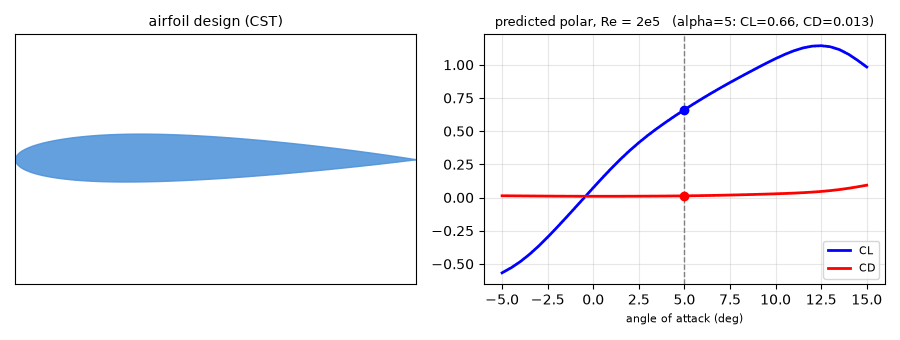
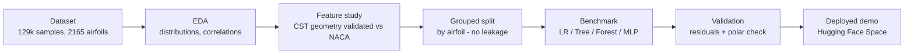
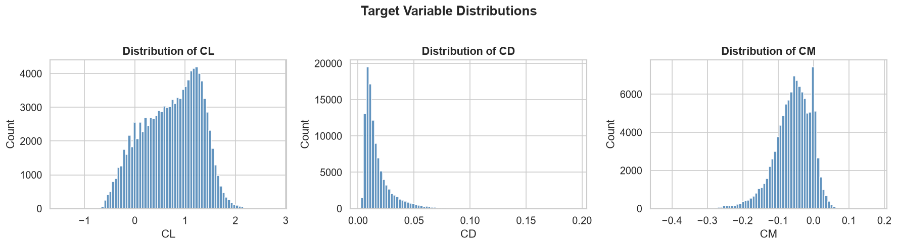
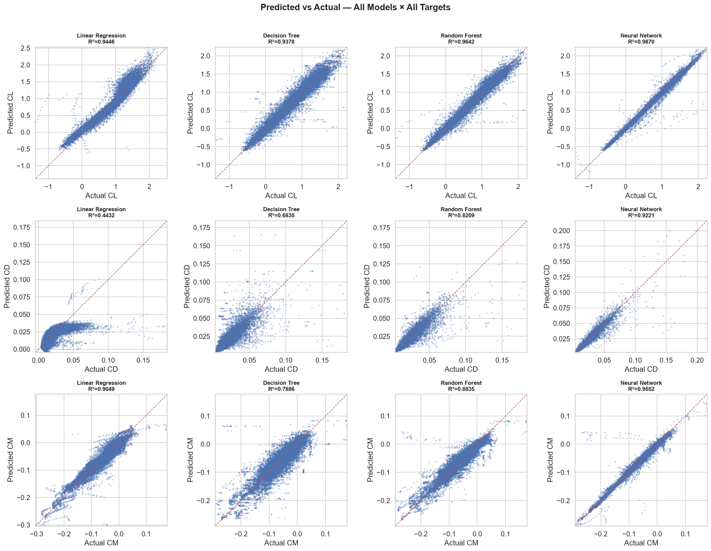
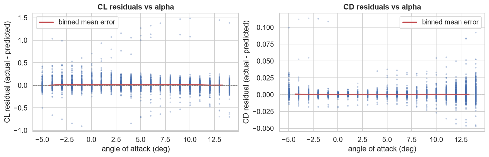
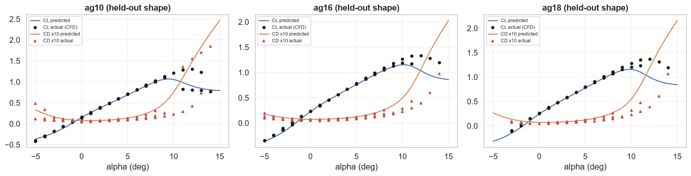

# ML Surrogate for Airfoil Aerodynamics

A neural network that predicts the lift, drag and moment coefficients of a
2D airfoil **~1000x faster than a CFD simulation**, straight from its CST
shape coefficients, angle of attack and Reynolds number. Pick any airfoil
design, get its full aerodynamic polar in under a millisecond.



The idea: CFD simulations of an airfoil take minutes to hours. I want a neural
network that gives me the lift, drag and moment coefficients in about a
millisecond, straight from the shape.

[](https://colab.research.google.com/github/priyanshu209006/surrogate_airfoils/blob/main/ML_Surrogate_Airfoil_Aerodynamics.ipynb)

**Live interactive demo (predict any custom design):**
[pk6306714-surrogate-airfoils.hf.space](https://pk6306714-surrogate-airfoils.hf.space)

---

## Dataset

- **Source**: [Agarwal et al., *Data* 2024 (MDPI)](https://www.mdpi.com/2306-5729/9/5/64) /
  [GitHub](https://github.com/kanakaero/Dataset-of-Aerodynamic-and-Geometric-Coefficients-of-Airfoils).
  Polars of ~2,900 UIUC airfoil geometries at low Reynolds numbers.
- **Used here**: 129,900 raw samples, of which **109,189 usable rows** across
  2,165 unique airfoils.
- **Inputs**: 18 CST shape coefficients (the mathematical "DNA" of the airfoil)
  + angle of attack α + Reynolds number.
- **Targets**: lift **CL**, drag **CD**, moment **CM**.

## Pipeline



## Models & results

All models trained on the same split. The test set contains **only airfoil
shapes never seen during training** (grouped split by `airfoil_name`), so the
scores measure generalization to new designs, not memorization.

| Model | Input | R² (CL) | R² (CD) | R² (CM) | MAE (CL) | MAE (CD) |
| --- | --- | --- | --- | --- | --- | --- |
| Linear Regression | 18 coefficients | 0.945 | 0.443 | 0.905 | 0.094 | 0.0066 |
| Decision Tree | 18 coefficients | 0.938 | 0.683 | 0.789 | 0.092 | 0.0035 |
| Random Forest | 18 coefficients | 0.964 | 0.821 | 0.883 | 0.065 | 0.0025 |
| **MLP (PyTorch)** | 18 coefficients | **0.990** | **0.926** | **0.970** | **0.029** | **0.0015** |
| 1D-CNN v1 | raw shape (2×96 surface points) | 0.984 | 0.897 | 0.950 | 0.037 | 0.0019 |
| 1D-CNN v2 (hybrid) | shape + coefficients | 0.986 | 0.904 | 0.954 | 0.033 | 0.0016 |

All training runs on an RTX 5050, and the whole notebook executes in a few
minutes. The MLP (~130k parameters) predicts in **~0.2-0.3 ms** per sample on
CPU, versus ~32 ms for the Random Forest and minutes-to-hours for the CFD runs
it replaces.

**About the CNNs:** after the MLP I tried a 1D-CNN that reads the rendered
airfoil surface instead of the coefficients. It landed slightly behind. Drag
is the stubborn target for every model here, since it depends on viscous
effects the outer shape only partly explains. The CNN isn't a failure though:
it shows the pipeline works on raw geometry, which is the approach that scales
to full CFD mesh data where no handy 18-number summary exists.

### What makes this more than a benchmark table

- **Geometry validated**: the CST-to-shape reconstruction was verified against
  the published NACA 0012/2412/4415/6412 geometry (thickness and camber match
  to within the fit tolerance). See the notebook.
- **Residual analysis**: errors concentrate in the non-linear stall region
  (high angle of attack), exactly where a surrogate is expected to struggle.
- **Polar validation on unseen airfoils**: full predicted CL/CD vs α curves
  overlaid with the actual simulation points for held-out shapes.
- **Architecture experiment**: MLP vs 1D-CNNs on raw shape vs coefficients,
  including *why* drag is harder than lift for all of them.
- **Live demo runs on arbitrary designs**, not just presets: edit the 18
  coefficients and watch the shape and polar respond.

## Notebook (everything is in it)

[`ML_Surrogate_Airfoil_Aerodynamics.ipynb`](ML_Surrogate_Airfoil_Aerodynamics.ipynb)
is fully executed. Click it on GitHub to see the EDA, feature study, training
curves, model comparison, residual analysis and polar validation with all
outputs. A few highlights:

| EDA | Model comparison |
| --- | --- |
|  |  |

| Residuals vs angle of attack | Held-out polar validation |
| --- | --- |
|  |  |

## Run it

```bash
pip install pandas numpy scikit-learn torch matplotlib seaborn openpyxl jupyter
jupyter notebook ML_Surrogate_Airfoil_Aerodynamics.ipynb
```
